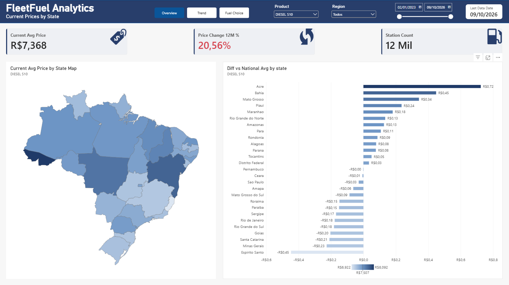
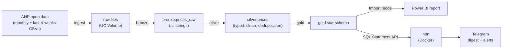
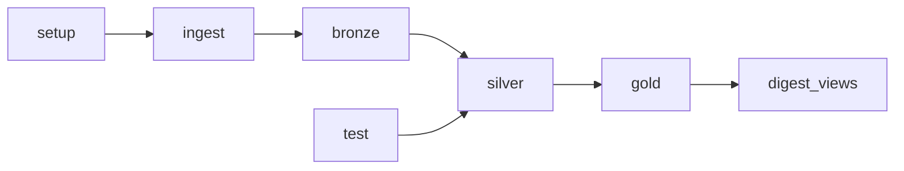
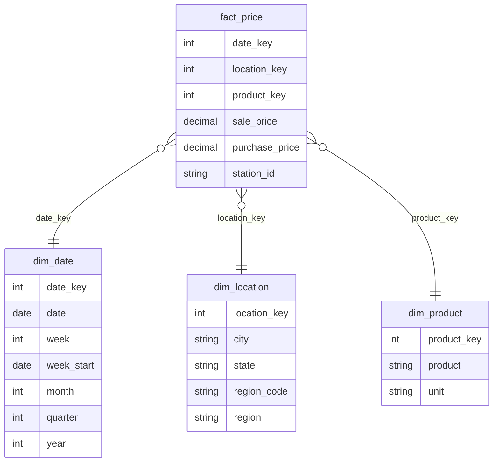
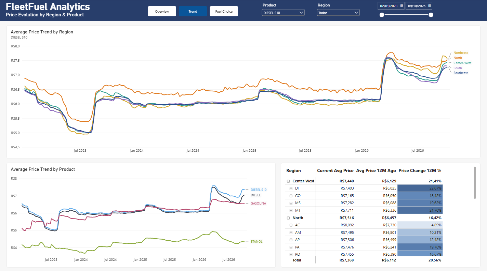
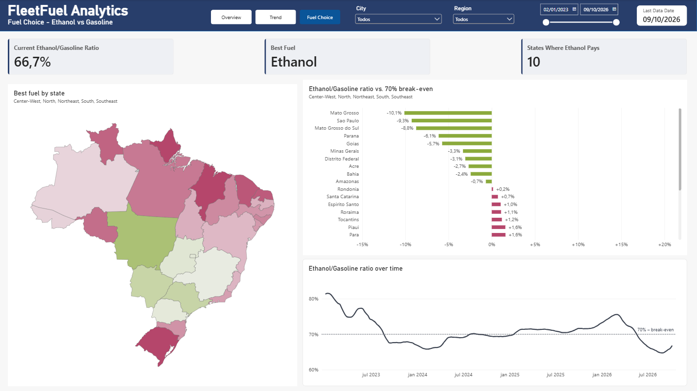
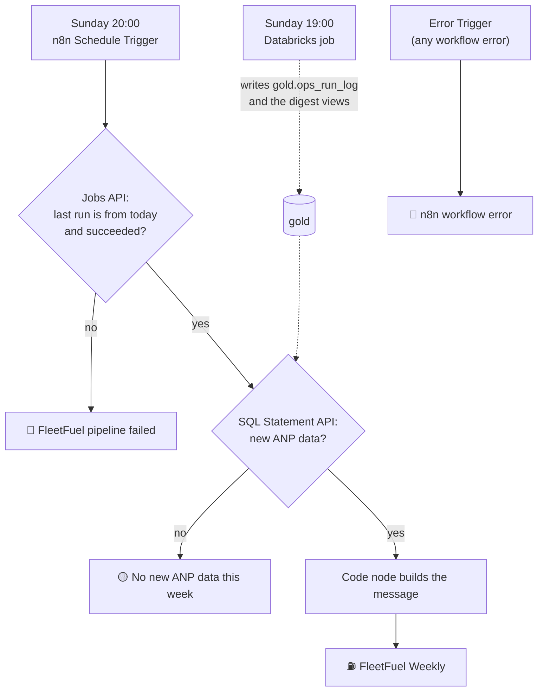

# FleetFuel Analytics

End-to-end data pipeline that turns Brazil's public fuel price survey (ANP) into a star schema on Databricks and a Power BI report that compares fuel prices across Brazil and shows where ethanol pays off over gasoline.

Built on **Databricks Free Edition** (serverless only), deployed as a **Databricks Asset Bundle**, and following the **medallion architecture** (raw → bronze → silver → gold) in **Unity Catalog**. A self-hosted **n8n** then sends a weekly Telegram digest and pipeline alerts, so the numbers reach the fleet manager without opening the report.

**Live dashboard:** [FleetFuel Analytics on Power BI](https://bit.ly/3W3Dxrv)



## Why

Fuel is one of the largest costs for any fleet: diesel for trucks, and ethanol or gasoline for flex-fuel cars. ANP publishes weekly prices from thousands of gas stations across Brazil, but only as raw CSVs. This project answers three questions:

- What is the average diesel, gasoline and ethanol price today, by state and region?
- How have prices moved over the last 12 months?
- In which states is ethanol cheaper to run than gasoline?

## Key findings

From the ANP data up to 9 Oct 2026, over the latest month of surveys (the numbers change with every refresh):

- **DIESEL S10** averages **R$ 7.28/l**, up **19.2%** over the last 12 months.
- **Acre** is the most expensive state for DIESEL S10, **R$ 0.83** above the national average.
- Nationally, ethanol costs **66.2%** of the gasoline price, so it pays off on average. It is the better choice in **10 states**, with the widest margins in Mato Grosso, São Paulo and Mato Grosso do Sul.

## Architecture



A single job, `anp_fuel_pipeline`, runs every step on serverless compute. It is scheduled every Sunday at 19:00 (America/Sao_Paulo), so new files from ANP flow through to gold without manual work:



| Task | Source | What it does |
|---|---|---|
| `setup` | [`src/00_setup.sql`](src/00_setup.sql) | Creates the catalog, the `raw`/`bronze`/`silver`/`gold` schemas and the landing Volume. |
| `ingest` | [`src/01_ingest.py`](src/01_ingest.py) | Finds the ANP diesel and gasoline/ethanol CSVs on the open data page, from `start_year` up to the latest published month. Files already in the Volume are skipped. ANP only publishes a month after it closes, so the task also saves the page's rolling "last 4 weeks" files as dated snapshots, which keeps the data current to the latest weekly survey. |
| `bronze` | [`src/02_bronze.py`](src/02_bronze.py) | Loads new CSVs (monthly files and weekly snapshots) into `bronze.prices_raw` as strings, with source file and load timestamp. Incremental and idempotent. |
| `test` | [`tests/run_tests.py`](tests/run_tests.py) | Runs the pytest suite for the silver rules on serverless. Silver does not run if a test fails. |
| `silver` | [`src/03_silver.py`](src/03_silver.py) | Renames columns to English, parses prices and dates, normalizes text, keeps DIESEL, DIESEL S10, GASOLINA and ETANOL, and keeps one row per station, product and day, which also resolves the overlap between weekly snapshots and monthly files. |
| `gold` | [`src/04_gold.sql`](src/04_gold.sql) | Rebuilds the star schema and a weekly aggregate, then appends one row to the run log `gold.ops_run_log`. |
| `digest_views` | [`src/05_digest_views.sql`](src/05_digest_views.sql) | Creates the views read by the n8n weekly digest: national averages, state changes and the ethanol/gasoline ratio for the latest week. |

### Gold model



`fact_price` has one row per station, product and survey day. `agg_price_weekly` holds the average, min and max price and the station count per state, region, product and week.

## Data quality

Each layer fails its task when a check does not pass, so bad data never reaches the report:

- **Bronze:** every loaded file has exactly as many rows as its CSV has data rows.
- **Silver:** sale price between R$ 1 and R$ 15 per liter, no null keys, and no more rows than bronze.
- **Gold:** no null keys in the fact table, every fact row matches its dimensions, and the fact table has the same row count as silver.
- **Unit tests:** the cleaning rules live in [`src/anp_fuel/silver_rules.py`](src/anp_fuel/silver_rules.py) as pure DataFrame functions. [`tests/test_silver_rules.py`](tests/test_silver_rules.py) tests them on small in-memory DataFrames.

## Power BI

The report connects to the Databricks SQL Warehouse in **Import** mode and reads only the `gold` schema. It is saved as a Power BI Project (`.pbip`), so the model and the report are plain text: the measures are in [`Medidas.tmdl`](powerbi/Fleet_Fuel_Analytics.SemanticModel/definition/tables/Medidas.tmdl).

- **Overview:** current average price, 12-month change, a map by state, and the difference to the national average.
- **Trend:** price over time by region and product.
- **Fuel Choice:** ethanol/gasoline price ratio by state and over time. Ethanol pays off when the ratio is below 70%, the usual break-even point given its lower energy content:

  `ratio = average ETANOL price ÷ average GASOLINA price`





## Weekly alerts (n8n)

The report answers questions when someone opens it. The alerts go the other way: every Sunday evening, one hour after the Databricks job, a self-hosted n8n reads the `gold` schema and sends a digest of the week to Telegram. The same setup warns when the pipeline fails or when ANP has published nothing new.



n8n polls Databricks on a schedule instead of being called by it: a local n8n is not reachable from the internet, so Databricks could not send it a webhook.

| Workflow | What it does |
|---|---|
| [`weekly_digest`](automation/workflows/weekly_digest.json) | Checks the last job run, reads the three digest views in one SQL statement and sends the digest. Skips the message when the job did not succeed today or brought no new data. |
| [`pipeline_alerts`](automation/workflows/pipeline_alerts.json) | Sends the failure and no-new-data alerts, and is the error workflow of `weekly_digest`, so a failing node also ends up in Telegram. |
| [`databricks_connection_test`](automation/workflows/databricks_connection_test.json) | Minimal query against the SQL Warehouse, useful to check credentials and the polling loop. |

The serverless warehouse may be stopped when n8n calls it, so every query is submitted with a wait timeout and then polled until it leaves `PENDING`/`RUNNING`, for up to two minutes.

A digest looks like this:

```text
⛽ FleetFuel Weekly — week of 05/10/2026

National average (vs last week)
• Diesel S10  R$7.37  ▼ 0.1%
• Diesel      R$7.05  ▲ 0.7%
• Gasoline    R$6.57  ▼ 0.1%
• Ethanol     R$4.37  ▬ 0.0%

Biggest Diesel S10 increases
1. PA  +1.3%   2. MS  +1.2%   3. RR  +1.0%

Ethanol vs gasoline
Ethanol pays in 10 of 27 states (ratio 66.5%)
Flipped to ethanol this week: none
Flipped to gasoline this week: none

⚠️ Spikes above 5%: none
```

The digest compares the latest week with the week before, while the report cards use the latest month, so the two can show different averages for the same product.

**Thresholds** are bundle variables, written to `gold.digest_config` and read by the views, so neither the SQL nor the messages hard-code them: `ratio_threshold` (ethanol pays below it), `spike_threshold` (weekly state increase, in %, flagged as a spike) and `min_stations` (states with fewer stations surveyed stay out of the rankings).

**Limitations:** n8n runs on a local machine, so nothing is sent if it is off on Sunday at 20:00; moving it to a VPS or n8n Cloud removes that. Telegram is used instead of WhatsApp because its bot API is free and official.

## How to run

**Requirements:** a Databricks workspace (Free Edition works) and the [Databricks CLI](https://docs.databricks.com/dev-tools/cli/install.html) authenticated to it.

1. Set `workspace.host` in [`databricks.yml`](databricks.yml) to your workspace URL.
2. Validate, deploy and run:

   ```bash
   databricks bundle validate
   databricks bundle deploy -t dev
   databricks bundle run anp_fuel_pipeline -t dev
   ```

3. Optional: override the bundle variables.

   ```bash
   databricks bundle deploy -t dev --var="catalog=my_catalog" --var="start_year=2024"
   ```

| Variable | Default | Description |
|---|---|---|
| `catalog` | `anp_fuel` | Unity Catalog catalog for all schemas. |
| `start_year` | `2023` | First ANP survey year to ingest. Ingestion always runs up to the current year. |
| `ratio_threshold` | `0.70` | Ethanol pays off when its price divided by the gasoline price is below this ratio. |
| `spike_threshold` | `5` | Week-over-week state price increase (%) flagged as a spike in the digest. |
| `min_stations` | `10` | Minimum stations surveyed in a state and week for it to enter the digest rankings. |

4. Open `powerbi/Fleet_Fuel_Analytics.pbip` in Power BI Desktop. In *Transform data → Edit parameters*, set `DatabricksHost` (your workspace host, without `https://`) and `HttpPath` (from your SQL Warehouse's *Connection details*), then refresh and sign in when prompted.

### Weekly alerts

**Requirements:** Docker, a Databricks personal access token and a Telegram bot (created with [@BotFather](https://t.me/BotFather)).

1. Create the environment file and fill it in. `N8N_ENCRYPTION_KEY` can be any long random string, e.g. from `openssl rand -hex 32`.

   ```bash
   cd automation
   cp .env.example .env
   ```

2. Start n8n and open <http://localhost:5678> to create the owner account.

   ```bash
   docker compose up -d
   ```

3. In n8n, create two credentials. Tokens live only there, encrypted in the `n8n_data` volume; the workflows read the non-secret settings (host, warehouse, job and chat IDs) from `.env`.
   - **Header Auth** named `Databricks PAT`: header `Authorization`, value `Bearer <your token>`.
   - **Telegram API** named `Telegram account`: the bot token.

4. Import the workflows from [`automation/workflows/`](automation/workflows/) (*Import from file* in the workflow menu), select the two credentials in the HTTP Request and Telegram nodes, and set `pipeline_alerts` as the error workflow of `weekly_digest` in its settings.
5. Run `weekly_digest` manually to check that the message arrives, then publish both workflows so the Sunday schedule is active.

## Project structure

```
├── automation/
│   ├── docker-compose.yml    # self-hosted n8n
│   ├── .env.example          # settings read by n8n (copy to .env)
│   └── workflows/            # n8n workflows exported as JSON, without credentials
├── databricks.yml            # bundle definition and variables
├── images/                   # report screenshots
├── resources/
│   └── anp_fuel_job.yml      # job with all tasks
├── src/
│   ├── 00_setup.sql
│   ├── 01_ingest.py
│   ├── 02_bronze.py
│   ├── 03_silver.py
│   ├── 04_gold.sql
│   ├── 05_digest_views.sql
│   └── anp_fuel/
│       └── silver_rules.py   # testable cleaning rules
├── tests/
│   ├── conftest.py
│   ├── run_tests.py          # runs pytest as a job task
│   └── test_silver_rules.py
└── powerbi/
    ├── Fleet_Fuel_Analytics.pbip
    ├── Fleet_Fuel_Analytics.Report/        # pages and visuals
    └── Fleet_Fuel_Analytics.SemanticModel/ # tables, relationships, measures (TMDL)
```

## Tech stack

Databricks (Unity Catalog, Delta Lake, serverless jobs, Asset Bundles) · PySpark · Spark SQL · pytest · Power BI (DAX, Power Query, PBIP/TMDL) · n8n (Docker Compose) · Databricks Jobs and SQL Statement Execution APIs · Telegram Bot API

## Data source

[ANP: Série histórica de preços de combustíveis](https://www.gov.br/anp/pt-br/centrais-de-conteudo/dados-abertos/serie-historica-de-precos-de-combustiveis), published by Brazil's National Agency of Petroleum, Natural Gas and Biofuels under its open data policy. The pipeline reads the monthly station-level files and the "last 4 weeks" files from the same page.
